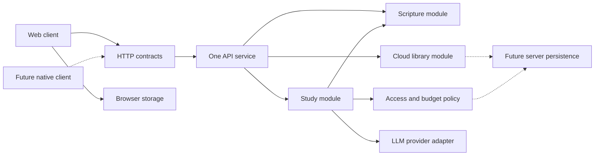

# Architecture

## Current prototype

The web reader is implemented with the full public-domain BSB corpus, book/chapter
navigation, browser-history-aware chapter URLs, and optional device-local last
chapter storage. Text is distributed as validated static book assets, so reading
does not depend on the API. The source and per-book checksums are pinned.

The reader also has persistent Light/Dark/System appearance. The Node API has
configurable text and image model adapters with application-level interfaces,
disabled by default. Its capability-status endpoint performs no inference. See
[model integration](model-integration.md) for provider settings and current limits.

Other study, account, saved-library, sync, and billing responsibilities below remain
future design constraints. See [the prototype decision](decisions/0002-static-reader.md).

## The user experience this structure supports

- A web app designed for tablet/desktop study alongside the Bible and usable on phones.
- Quiet reading with selection/menu actions, plus a proactive guided study mode.
- Guest reading and device-local notes, highlights, saved findings, and questions.
- Optional accounts for cloud backup/sync and potentially larger study allowances.
- Future subscriptions to support heavier LLM usage.
- A possible native Android/iOS client without replacing the backend.
- Conservative evangelical/Protestant study, with sources and fair representation
  of differing conservative interpretations.

These describe the intended application; only the reader slice above is implemented.

## Overall shape

One API service contains feature modules. The web app is a separate client. This
is a modular monolith on the backend, organized in a TypeScript monorepo.

The diagram describes runtime relationships. At build time, clients and API import
the contracts package; contracts never import the API implementation. Both
applications may import shared domain vocabulary. Domain code has no dependency
on either application, transport, storage, or external services.

Do not split modules into independent services until measured scaling or team
needs justify the operational cost. No message bus, microservice fleet, generalized
plugin framework, or separate mobile app is needed for the first version.

## Responsibilities and dependencies

| Boundary          | Owns                                                         | Must not own                                                   |
| ----------------- | ------------------------------------------------------------ | -------------------------------------------------------------- |
| Web features      | Reader and study presentation; personal-library interactions | Provider credentials, account authorization, usage enforcement |
| Browser storage   | Device persistence and migrations                            | Cloud ownership or subscription truth                          |
| Shared domain     | Scripture references and reusable study vocabulary/rules     | Browser, React, Fastify, ORM, or LLM SDK details               |
| HTTP contracts    | Request/response shapes and runtime validation               | Database records or provider-specific objects                  |
| Scripture module  | Text, editions, references, provenance, and content rights   | UI state or LLM-specific transport                             |
| Study module      | Study use cases, prompts, sources, and orchestration         | Payment vendor objects or direct browser state                 |
| Access module     | Actor resolution, capabilities, quotas, and spending policy  | Reader rendering or client-supplied subscription claims        |
| Cloud library     | Authorized account records and future sync operations        | The only copy of guest work                                    |
| Platform adapters | Provider and persistence integration details                 | Theological policy or feature authorization decisions          |

Feature modules should expose narrow operations. Route handlers validate and
translate requests; use cases perform work. Define ports beside the use cases
that need them, and implement adapters at the platform boundary. Do not create
empty service/repository/controller layers simply to fill this structure.

## Data ownership: local first, cloud optional

Guest work belongs to the device. Implement IndexedDB for structured saved work;
use localStorage only for small preferences. Local saves should succeed without
an account or a network connection, once the relevant content is available.

Cloud sync is an additive feature. On opt-in, associate records with an authenticated
account and import/merge local work using stable IDs. Define revisions, conflict
resolution, deletions, and retries before building the sync protocol. The device
copy remains until successful acknowledgment; account changes must not silently
upload one person's local work into another person's account.

Browser storage can be cleared or evicted. Local export and an honest backup status
should accompany personal saving. This architecture does not yet implement offline
Bible availability, a service worker, export, or synchronization.

## Guest access and optional login

Public reading and local saves do not need authentication. Account-owned cloud
records do: authenticate requests and check ownership on every cloud operation.
Do not put a mandatory authentication check around the entire application.

Anonymous study access can use a server-issued, signed, HttpOnly guest identifier.
That identifier is not a reliable per-person anti-abuse boundary. Before enabling
paid model calls, combine server-side counters and budget reservation with
appropriate gateway/IP throttling, request/output limits, and concurrency limits.
Plan an authentication mechanism that can serve both web and native clients;
select the identity provider when account features are implemented.

## LLM cost and access policy

Every paid model call goes through the server. The browser never receives a
provider key. The access module decides capabilities and budgets independently
of a login vendor or future payment provider. No allowance amounts or subscription
tiers are committed in this scaffold.

Before the first live model endpoint, implement:

1. Input validation and per-request token/output ceilings.
2. Guest/account request and concurrency limits backed by durable state.
3. Atomic budget reservation, actual usage recording, and failure reconciliation.
4. A global spending stop, bounded retries, and provider cancellation/timeouts.
5. A reusable-response cache where sources, edition, model/prompt version, and
   study settings allow safe reuse. Exclude private user notes from shared caches.

Billing can later update a server-side entitlement record through verified,
idempotently processed provider events. Study use cases consume capabilities and
budgets. Payment state must not become the application's identity model.

The API exposes health and configured AI availability, with no generation route.
Provider execution is available internally to future trusted study use cases;
the default configuration disables both text and images.

## Scripture, sources, and translation rights

Start with the public-domain Berean Standard Bible from its official distribution.
At import, pin the edition/date and checksum, retain source/rights metadata, and
define canonical book IDs and versification. Keep passage anchors independent of
the reader's selected translation, with explicit mapping when editions differ.

The first import is complete. Static book files and a provenance manifest live in
`apps/web/public/bibles/bsb`; `scripts/import-bsb.mjs` reproducibly imports the
checksum-pinned official third-printing text. Its source Last-Modified value was
July 31, 2026. The shared catalog uses USFM book IDs. This first import preserves
verse text and numbering but does not include footnotes or paragraph/poetry layout.

For future translations, store display/caching/redistribution and LLM-processing
permissions separately. An API display license is not automatically an AI license.
Apply the same source review to lexicons, commentaries, images, and maps. Retain
references when users save a study result. Present quoted Scripture, source claims,
AI interpretation, and personal notes distinctly.

Official BSB licensing: <https://berean.bible/licensing.htm>.

## Runtime flows

### Reading and saving

1. The client obtains approved Scripture content through the distribution path
   chosen when the reader is implemented.
2. Reading position and preferences remain device-local.
3. A note/highlight/finding saves through the client storage adapter.
4. If the user opts into cloud sync, an authenticated and authorized sync request
   imports or reconciles those records without replacing their IDs.

### Study

1. The client submits a passage reference and question or guided activity.
2. The API validates the request and resolves a guest/account actor.
3. Study checks content rights, access policy, reusable results, and usage budget.
4. A provider adapter obtains bounded output and reports actual usage.
5. Study returns an explanation with source references and clear content types.
6. The client can save the result locally regardless of account status.

The sequence applies to both user-initiated questions and proactive suggestions.
Opening a chapter should not imply unlimited model requests; choose caching and
generation timing deliberately when guided mode is built.

## Build and deployment

- React + Vite builds a static web client. A separate Fastify process serves the API.
- Local development uses Vite's `/api` proxy; no permissive CORS policy is required.
- Production should serve static assets and proxy `/api` under one origin. Native
  clients can call the same versioned HTTPS API directly.
- Internal shared TypeScript packages are bundled into their consuming application.
  Provider/server packages must never enter the browser dependency graph.
- The API app factory does not open a port. `server.ts` owns environment configuration,
  listening, logging, and process shutdown. This keeps HTTP tests independent of
  external services.
- CI runs formatting checks, strict type checks, HTTP/configuration tests, and builds.

The current hosted prototype is a static reader; `.openai/hosting.json` identifies
the Sites project and `npm run build:site` writes root `dist/`. The API is not
deployed as part of that static preview. There is no database, login provider,
LLM provider, or billing account configured. PostgreSQL remains a future candidate.

## First implementation slices

1. Completed: import and identify the current official BSB text; build passage reading.
2. Add IndexedDB saving and export for a note/highlight, without login.
3. Add server-side guest usage controls before one source-backed LLM study flow.
4. Add guided chapter suggestions using the same study boundary.
5. Introduce accounts, explicit local-to-cloud import, and sync when needed.
6. Add paid entitlements if usage economics require them.
